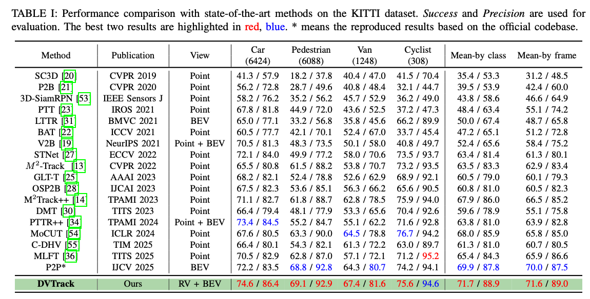
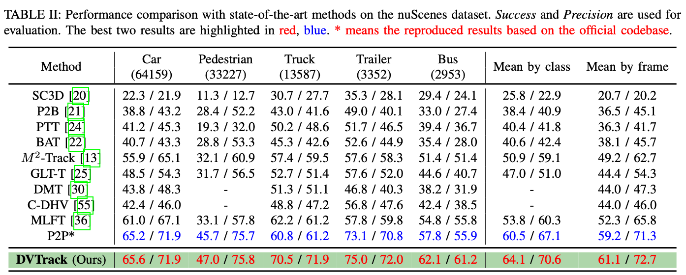
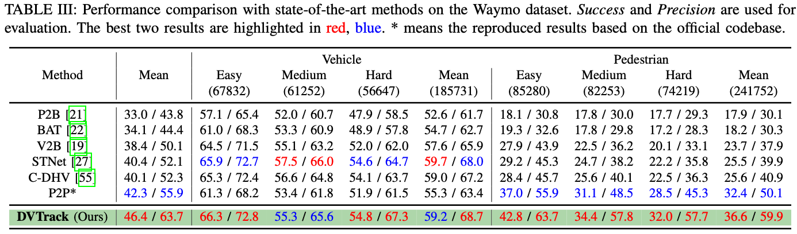

# DVTrack 

The official implementation of the paper: 

**DVTrack: Dual-View Alignment-Attention for 3D
Point Cloud Tracking in Intelligent Transportation Systems**


<div id="top" align="center">
<p align="center">

</p>
</div>

## 🔥 Highlights

**DVTrack** is a strong cross-view tracking framework for 3D SOT on LiDAR point clouds that have:

- *Elegant tracking pipeline*.
- *SOTA performance on KITTI, NuScenes and Waymo*.
- *High efficiency*.

<div id="top" align="center">
<p align="center">

</p>
</div>

<div id="top" align="center">
<p align="center">

</p>
</div>

<div id="top" align="center">
<p align="center">

</p>
</div>

## 📢 News

> [!IMPORTANT]
> If you have any question for our codes or model weights, please feel free to concat me at sifanjay@gmail.com and misayuanzilee@163.com.


## 📋 TODO List

- [ ] release the arxiv version.
- [ ] release the installation, training, and testing details.
- [ ] release the implementation of our model.

## 🕹️ Getting Started

- [Installation](https://github.com/StiphyJay/DVTrack/tree/main/docs/INSTALL.md)

- [Data Preparation](https://github.com/StiphyJay/DVTrack/tree/main/docs/DATA.md)

- [Training](https://github.com/StiphyJay/DVTrack/tree/main/docs/TRAINING.md)

- [Testing](https://github.com/StiphyJay/DVTrack/tree/main/docs/TESTING.md)


## ❤️ Acknowledgement

Our implementation is based on [Open3DSOT](https://github.com/Ghostish/Open3DSOT), [BEVTrack](https://github.com/xmm-prio/BEVTrack) and [MMDetection3D](https://github.com/open-mmlab/mmdetection3d). Thanks for the great open-source work!

## ⭐ Citation

If any parts of our paper and code help your research, please consider citing us and giving a star to our repository.

```bibtex
@article{dvtrack,
 title={DVTrack: Dual-View Alignment-Attention for 3D
Point Cloud Tracking in Intelligent Transportation Systems},
 year={2026}
}
